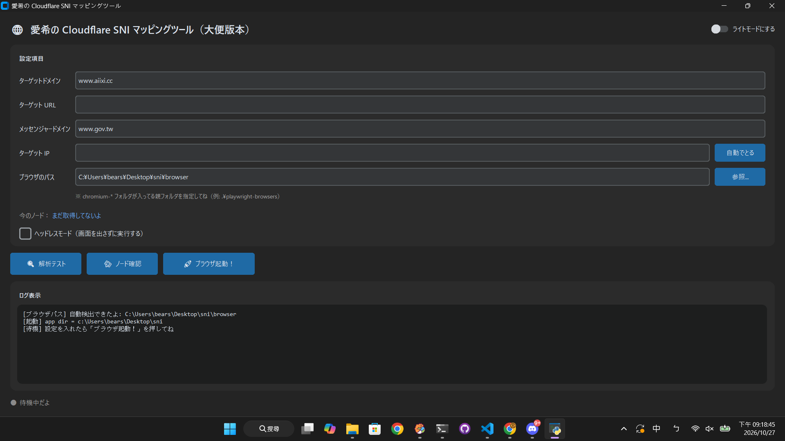

# Cloudflare SNI マッピングツール / CF SNI 映射工具

透過 Chromium 的 `--host-resolver-rules` 參數，把指定域名強制解析到自訂 IP，
**同時保留真實的 SNI 與 Host 頭**。適用於「DNS 被攔截、但 IP 可達」的網路環境。

> ⚠️ **進階使用者工具**。請自行確認使用情境符合當地法規、目標網站的服務條款，
> 以及所在網路環境（學校 / 公司）的使用政策。

---

## ✨ 功能

- **域名 → 自訂 IP 映射**：等價於 `curl --resolve`，但作用於完整瀏覽器
- **信使域名池**：用未被封鎖的 Cloudflare 域名解析出可用邊緣 IP
- **`/cdn-cgi/trace` 節點查詢**：即時顯示命中哪個 CF 邊緣節點（`HKG` / `NRT` / `TPE` …）
- **離線瀏覽器路徑**：可手動指定 Playwright 瀏覽器所在資料夾，適合內網 / 無網環境
- **自動偵測瀏覽器**：解壓到程式同目錄時免設定
- **深 / 淺色主題**、日文介面
- **完整日誌**：GUI ログ + `app.log` + stdout 三通道

---

## 🖼 介面



---

## 🚀 下載即用（一般使用者）

### 1. 到 [Releases](../../releases) 頁面下載**兩個** zip

| 檔案 | 內容 | 大小 |
|---|---|---|
| `sni-tool-vX.Y.Z-windows.zip` | 主程式（含 Playwright driver，不含瀏覽器） | 約 40–60 MB |
| `playwright-browsers-vX.Y.Z-windows.zip` | Chromium 瀏覽器本體 | 約 150–200 MB（壓縮後） |

> ⚠️ **兩個 zip 必須從同一個 Release 下載**。混用不同版本的 app 和瀏覽器會導致啟動失敗。

### 2. 解壓到**同一個資料夾**

```
sni-tool\
├── app.exe
├── _internal\
└── playwright-browsers\      ← 瀏覽器 zip 解壓到這裡
    └── chromium-XXXX\
```

### 3. 雙擊 `app.exe`

啟動時會自動偵測 `playwright-browsers\`，日誌會顯示：

```
[ブラウザパス] 自動検出: ...\playwright-browsers
```

不需要設定環境變數、不需要安裝 Python、不需要連網。

### 4. 填入設定，點「🚀 ブラウザ起動」

| 欄位 | 說明 |
|---|---|
| ターゲットドメイン | 被封鎖的目標域名（例：`www.aiixi.cc`） |
| ターゲット URL | 完整 URL（可留空，預設 `https://<域名>/`） |
| メッセンジャードメイン | 學校 / 公司放行且走 Cloudflare 的域名（例：`www.gov.tw`） |
| ターゲット IP | 目標 IP。留空時自動用信使域名解析 |
| ブラウザパス | Chromium 所在資料夾。留空用預設 |
| ヘッドレスモード | 不顯示瀏覽器視窗 |

---

## 🐍 從原始碼執行（開發者）

### 需求

- Python 3.11（3.12 也可，但 PyInstaller 打包建議 3.11）
- Windows 10 / 11（其他平台理論上可行但未測試）

### 步驟

```bash
# 1. 安裝依賴
pip install -r requirements.txt

# 2. 下載 Chromium
playwright install chromium

# 3. 執行
python app.py
```

---

## 📴 離線 / 內網環境

如果目標電腦無法連網下載 Chromium：

**A. 在有網的電腦上下載瀏覽器**

```powershell
# PowerShell
$env:PLAYWRIGHT_BROWSERS_PATH = "C:\playwright-browsers"
playwright install chromium
```

**B. 把 `C:\playwright-browsers` 整個資料夾拷到目標電腦**（例如 `D:\tools\playwright-browsers`）

**C. 在 GUI 的「ブラウザパス」欄位填入該路徑**，或把資料夾命名為 `playwright-browsers` 放在 `app.exe` 同目錄（自動偵測）

程式會自動設定 `PLAYWRIGHT_BROWSERS_PATH`，**不需要**設定系統環境變數。

---

## 🔧 原理

Chromium 支援 `--host-resolver-rules="MAP <域名> <IP>"` 啟動參數，
讓瀏覽器在 DNS 解析階段就把域名映射到指定 IP，
但後續 TLS 握手依然使用原始域名作為 SNI、HTTP 請求使用原始域名作為 Host。

這在 Cloudflare 的 anycast 架構下成立：CF 邊緣 IP 全球共享，
具體路由到哪個客戶的源站由 SNI 決定。因此可以用「未被封鎖的 CF 域名解析出的 IP」
去訪問「被封鎖但也在 CF 上的目標域名」。

---

## ❓ 常見問題

### Q：啟動時報 `Executable doesn't exist at ...`

瀏覽器路徑沒設對。三個檢查點：

1. 「ブラウザパス」欄位是否填了正確路徑（要包含 `chromium-*` 子資料夾的那一層）
2. 瀏覽器 zip 和 app zip 是否從**同一個 Release** 下載
3. 日誌中 `[実行ファイル]` 那行指向的路徑是否存在

### Q：`421 Misdirected Request`

Cloudflare 判斷 SNI 和 Host 不一致。通常是目標域名不在 Cloudflare 上，
或信使 IP 和目標站點屬於不同的 CF 帳號 / 方案。

### Q：`/cdn-cgi/trace` 查不到節點

信使 IP 可能被學校 / 公司攔截，或本身不可達。試著換一個信使域名重試。

### Q：學校封鎖的是 SNI 而不是 IP

本工具**不修改 SNI**，只修改 DNS 解析結果。如果學校是基於 SNI 黑名單封鎖，
本工具無效。請改用其他方案。

---

## 🛠 自行建置

見 [.github/workflows/release.yml](.github/workflows/release.yml)。
打上 `v*` 標籤（例如 `git tag v1.0.0 && git push --tags`）即自動觸發建置與發佈。

本機建置：

```bat
pip install setuptools==81.0.0
pip install -r requirements.txt
pip install pyinstaller==5.13.2

pyinstaller --onedir --console --clean --noupx ^
  --collect-all=playwright ^
  --collect-all=customtkinter ^
  --hidden-import=greenlet ^
  --hidden-import=pyee ^
  app.py
```

---

## ⚠️ 免責聲明

本工具僅供網路診斷、研究與個人學習使用。使用者需自行負責：

- 確認使用情境符合當地法規
- 確認符合目標網站的服務條款
- 確認符合所在網路環境（學校 / 公司）的使用政策

作者不對任何濫用行為負責。

---

## 📄 授權

[MIT License](LICENSE)